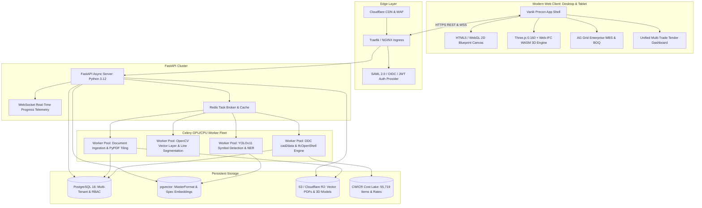
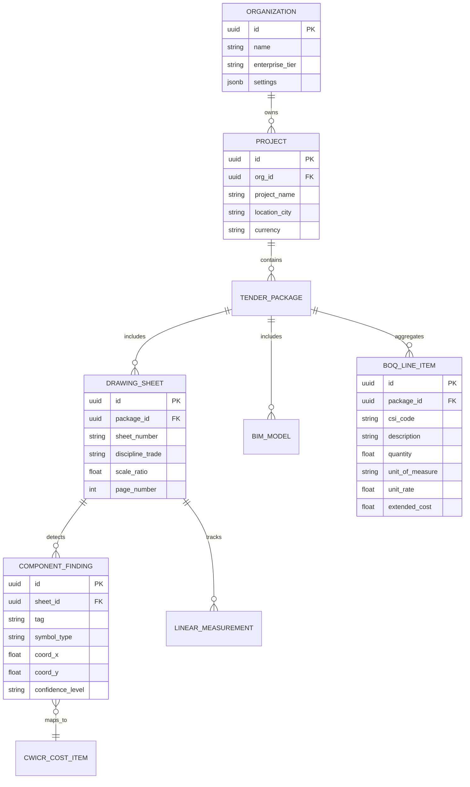

# Vanik Precon: System Architecture Specification

---

## 1. High-Level Architecture Overview



---

## 2. Component Subsystems

### 2.1 2D Drawing Engine Subsystem
* **Rendering Strategy:** Combines an SVG/Vector path parsing pass with an HTML5 `<canvas>` rendering loop running in an `OffscreenCanvas` Web Worker.
* **Coordinate Mapping:** Transforms raw PDF points (1/72 inch) into canvas viewport pixels at variable zoom levels ($0.1\times$ to $8.0\times$) while maintaining sub-millimeter precision.
* **Bounding Box Indexing:** Spatial R-Tree index stored in client memory maps every extracted text label, diffuser, and fire damper symbol to a unique screen coordinate for instantaneous hover response and table sync.

### 2.2 In-Browser 3D BIM Subsystem
* **Zero-Server Processing:** Uses `web-ifc` compiled to WebAssembly (`web-ifc.wasm`), running directly inside the user's browser.
* **Memory Management:** Geometry meshes are extracted into typed `Float32Array` buffers and attached to Three.js `BufferGeometry` instances.
* **Property Tree Inspection:** Queries IFC STEP entity records (`IFCWALL`, `IFCDUCTSEGMENT`, `IFCVALVE`) to retrieve manufacturer names, fire ratings, dimensions, and system classifications.

### 2.3 5-Layer AI Pipeline
```
[Raw Blueprints]
       │
       ▼
┌────────────────────────────────────────────────────────┐
│ Layer 1: Spatial OCR & Document Preprocessing          │  Extracts text strings and coordinates
└────────────────────────────────────────────────────────┘
       │
       ▼
┌────────────────────────────────────────────────────────┐
│ Layer 2: Named Entity Recognition (CSI MasterFormat)   │  Identifies AHUs, diffusers, dampers
└────────────────────────────────────────────────────────┘
       │
       ▼
┌────────────────────────────────────────────────────────┐
│ Layer 3: CAD Vector Color-Layer Classification        │  Segments Supply, Return, and Exhaust
└────────────────────────────────────────────────────────┘
       │
       ▼
┌────────────────────────────────────────────────────────┐
│ Layer 4: Vision-Language Model Symbol Detection       │  Finds unlabeled icons via YOLOv11
└────────────────────────────────────────────────────────┘
       │
       ▼
┌────────────────────────────────────────────────────────┐
│ Layer 5: Parametric SMACNA / Engineering Rules         │  Computes sheet gauge & insulation m²
└────────────────────────────────────────────────────────┘
       │
       ▼
[Structured WBS / BOQ Table]
```

---

## 3. Data Schema & Entities



---

## 4. Security & Compliance Baseline
* **Authentication:** SAML 2.0 / OpenID Connect with multi-factor authentication (MFA).
* **Authorization:** Role-Based Access Control (RBAC) enforced at database query level using PostgreSQL Row-Level Security (RLS).
* **Data Privacy:** Customer blueprint files and bid pricing datasets are never used to train public foundational AI models.
* **Encryption:** AES-256 GCM encryption at rest in storage buckets; TLS 1.3 encryption for all network traffic.
