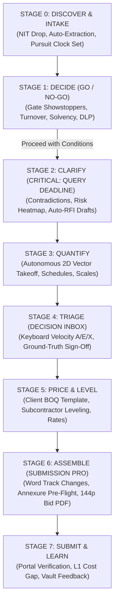

# Preconstruct — End-to-End Platform Redesign & Unified Domain Architecture

**Status:** Living Design Specification & Architectural Foundation  
**Scope:** From-Scratch Redesign of Platform Architecture, Information Flow, Unified Domain Graph, and Ergonomic User Journeys  
**Based On:** Research into Togal.AI, Kreo/Beam AI, ContraVault AI, Nexizo, Tenderkart, Boon AI, CPPP/GeM Legal Directives, and Ground-Truth Estimator Workflows.

---

## 0. Critical Rigor & Source-of-Truth Re-anchoring

Before designing on top of previous drafts, we must address and correct four core technical and legal ambiguities in prior specifications:

### 1. Parametric Formulas & Ground-Truth Consistency
- **Duct Area Formula Unit Conversion:** The surface area formula must correctly divide by $10^3$ when multiplying perimeter in millimeters ($P_{\text{mm}} = 2(W+H)$) by length in meters ($L_{\text{m}}$):
  $$A_{\text{rect}} = \frac{2(W + H) \times L}{1000} \quad [\text{m}^2]$$
- **Configurable Standard Rules:** Galvanized sheet metal thickness (IS 655:2018 / SMACNA) depends on **pressure classification** (Low $\le 500\text{ Pa}$, Medium $\le 1000\text{ Pa}$, High $\le 2500\text{ Pa}$) and reinforcement spacing, not purely static single-dimension cutoffs.
  - *Architectural Decision:* Gauge rules are stored in a versioned, editable **Rule Table** within the enterprise Company Vault, citing standard clauses, rather than hardcoded in front-end math.

### 2. Legal & Compliant Tender Data Access
- Central Public Procurement Portal (CPPP / `eprocure.gov.in`) and Government e-Marketplace (GeM) enforce CAPTCHAs and strict Terms of Service prohibiting headless bot scrapers and CAPTCHA-bypassing scripts.
  - *Compliant Architecture:* Preconstruct utilizes **three legitimate ingestion vectors**:
    1. Direct folder/ZIP user drop (100% compliant, primary).
    2. Forwarded tender alert inboxes (`tenders@<org>.preconstruct.app` parsing official notification emails).
    3. Authorized, licensed commercial aggregator APIs (e.g., Tenderbook, BidAssist Pro, SAM.gov REST API, TED Europa eForms Open Data API).

### 3. Pantone Design Language Verification
- Standardizing strictly on verified, non-glare architectural tokens:
  - Base: **Pantone 11-4201 Cloud Dancer** (`#F0EEE9`)
  - Accent: **Pantone 17-1230 Mocha Mousse** (`#A47864`)
  - State Tokens: Semantic CSS variables (`--color-measured`, `--color-read`, `--color-look`, `--color-void`) with verified WCAG AAA contrast ratios.

---

## 1. Core Architectural Shift: The "Pursuit" Domain Model

The previous module-centric paradigm (6 disconnected tabs) created mental friction: findings lived inside the module that discovered them, forcing estimators to manually reconcile contradictions with BOQ lines, risk models, and tender forms.

### The Paradigm Shift: From Tabs to an Interconnected Graph

```
OLD PARADIGM (Siloed Modules):
[Tenders & PQ] ──(isolated)──> [Contract Diff] ──(isolated)──> [2D Takeoff] ──(isolated)──> [BOQ Table]

NEW PARADIGM (Unified Pursuit Graph):
                       ┌────────────────────────┐
                       │     PURSUIT OBJECT     │
                       │ (One Clock, One Scope) │
                       └───────────┬────────────┘
                                   │
              ┌────────────────────┼────────────────────┐
              ▼                    ▼                    ▼
     ┌─────────────────┐  ┌─────────────────┐  ┌─────────────────┐
     │  EVIDENCE LAKE  │  │ FINDINGS GRAPH  │  │ DECISION INBOX  │
     │ Drawings, GCC,  │  │ Contradictions, │  │ 1-Click Triage: │
     │ SCC, Specs, BOQ │  │ Quantities, PQ  │  │ Single Source of│
     │ (Page Anchors)  │  │ (Interconnected)│  │ Truth Action    │
     └─────────────────┘  └─────────────────┘  └─────────────────┘
              │                    │                    │
              └────────────────────┼────────────────────┘
                                   │
         ┌─────────────────────────┴─────────────────────────┐
         ▼                         ▼                         ▼
 ┌───────────────┐         ┌───────────────┐         ┌───────────────┐
 │ CLARIFY LENS  │         │ QUANTIFY LENS │         │  PRICE LENS   │
 │ RFI Sheet,    │         │ 2D Canvas,    │         │ Client BOQ,   │
 │ Contradictions│         │ Schedule Sync │         │ Vendor Level  │
 └───────────────┘         └───────────────┘         └───────────────┘
```

1. **One Pursuit Object:** Represents the entire bid pursuit. Every module is a reactive view or "lens" over the pursuit's shared state.
2. **The Evidence Graph:** Every finding (a failed PQ requirement, an 11kV vs 33kV contradiction, a 28.5m duct run, a vendor exclusion) is anchored to a persistent document/drawing coordinate.
3. **The Persistent Evidence Viewer:** A single, universal right-hand document/drawing canvas active across all views. Selecting any finding immediately scrolls and highlights the source evidence.
4. **The Unified Decision Inbox:** Consolidates review queues, failed PQ gates, contradiction resolutions, and low-certainty takeoff items into a single, high-velocity human-in-the-loop triage center.
5. **Role Lenses (Not Separate Copies):** *Legal*, *Commercial*, *Technical*, and *Executive* are dynamic filters and aggregations over the same live data graph—preventing data drift.
6. **The Company Vault:** Centralized, reusable repository of corporate financials, past project credentials, machinery lists, standard rate libraries, and lessons learned.

---

## 2. End-to-End User Journey: The 8-Stage Spine

Workflows are organized strictly by **chronological urgency** (what is due first), keeping the team ahead of critical portal cut-offs:



---

## 3. Detailed Stage Breakdown & Interaction Design

### Stage 0: Discover & Intake
- **The Pursuit Clock:** Upon folder drop, Preconstruct extracts four critical timestamps:
  1. *Pre-Bid Query Submission Deadline* (Urgency Level 1 — usually 7–10 days before bid opening).
  2. *Pre-Bid Meeting Date & Mode* (Physical / Video Conference).
  3. *Bid Submission Portal Cut-off* (Urgency Level 2).
  4. *Technical Bid Opening Date*.
- **Autonomous Set Organization:** Files are indexed into a structured tree:
  - Volume I: Commercial Conditions (NIT, GCC, SCC, Form Annexures).
  - Volume II: Technical Specifications & Brand Make Lists.
  - Volume III: Bill of Quantities (Priced Template / Unpriced Schedule).
  - Volume IV: Tender Drawing Sheets (HVAC, Electrical, Plumbing, Architecture).

### Stage 1: Decide (Go / No-Go Scorecard)
- **Objective:** Prevent bidding on unviable or disqualifying tenders within 30 minutes of intake.
- **Automated Gate Checking:** Cross-references Volume I against the **Company Vault**:
  - *Financial Turnover Gate:* Compares past 3 years' audited average against tender minimum.
  - *Single Work Experience Gate:* Compares largest single completed project value.
  - *Bank Solvency Certificate:* Verifies against active banker credit limits.
  - *Defect Liability Period (DLP) Gate:* Flags commitments $> 24\text{ months}$ as potential commercial showstoppers.
- **Outcomes:**
  - `Bid Confirmed` $\rightarrow$ Proceeds immediately.
  - `No-Bid` $\rightarrow$ Logs reason in Company Vault (builds win/loss intelligence).
  - `Bid with Conditions` $\rightarrow$ Instantly seeds Stage 2 with mandatory amendment queries.

### Stage 2: Clarify (Pre-Bid Query Deadline)
- **Objective:** Surface all legal, engineering, and commercial contradictions before the client's query submission portal locks.
- **Cross-Document Discrepancy Graph:**
  - Detects clashes between drawings and specifications (e.g., Drawing SLD shows 11kV, HVAC specs mandate 33kV).
  - Detects clashes between GCC and SCC (e.g., GCC 90-day payment vs SCC 30-day payment).
- **Interactive Pre-Bid RFI Generator:**
  - Auto-drafts formal queries formatted to the client's mandatory RFI table.
  - Includes *Tender Clause Reference*, *Original Clause Text*, *Ambiguity Identified*, and *Proposed Amendment*.
  - 1-Click copy / direct export to Excel and client-ready cover letter.
- **Liquidated Damages & Risk Modeler:**
  - Interactive scenario slider calculating daily and weekly exposure:
    $$\text{Exposure} = \min\left(\text{Contract Value} \times 0.005 \times \frac{\text{Days}}{7},\; \text{Contract Value} \times 0.10\right)$$
  - Highlights the statutory 10% ceiling (reached at 140 days) with visual breach alerts.

### Stage 3: Quantify (Autonomous 2D/3D Takeoff)
- **Objective:** Measure 100% of physical quantities without manual polyline tracing.
- **5-Layer Takeoff Engine:**
  - Spatial OCR $\rightarrow$ Named Entity Recognition $\rightarrow$ CAD Layer Segmentation $\rightarrow$ VLM Symbol Counting $\rightarrow$ Parametric Sizing.
- **Two-Way Coordinate Synchronized Highlighting:**
  - Hovering a duct run in the schedule highlights the CAD vector on the canvas.
  - Clicking any element on the blueprint navigates to its schedule derivation row.
- **High-Velocity Tools:**
  - `V` — Select & Pan
  - `L` — Linear Measurement
  - `R` — Rectangular / Area Measurement
  - `C` — Symbol Counting
  - `S` — Interactive Scale Calibration (validates against known room bounding boxes)

### Stage 4: Triage (The Unified Decision Inbox)
- **Objective:** Eliminate estimator fatigue by replacing fragmented review tabs with a single keyboard-driven inbox.
- **Triage Anatomy:**
  - Left: Zoomed high-contrast drawing crop / document clause snippet.
  - Center: Proposed value, confidence derivation, and alternative options.
  - Right: Keybinding actions:
    - Press `A` $\rightarrow$ **Approve** proposed value (instantly syncs to BOQ).
    - Press `E` $\rightarrow$ **Edit** value or pick alternative standard gauge.
    - Press `X` $\rightarrow$ **Reject** or escalate to Pre-Bid RFI query.
    - Press `J` / `K` $\rightarrow$ Navigate next / previous.
    - Press `G` $\rightarrow$ **Group Approve** identical items (e.g., 12 matching supply air diffusers).

### Stage 5: Price & Level (Client BOQ & Subcontractor Matrix)
- **Client BOQ Structure First:** Automatically maps measured quantities into the tender's official pricing format (preserving original item numbers, descriptions, and units).
- **Subcontractor Quote Leveling Matrix:**
  - Ingests incoming PDF proposals from specialized subcontractors.
  - Standardizes quotes side-by-side against CSI MasterFormat / CPWD codes.
  - **Scope-Gap & Hidden Exclusion Engine:** Detects excluded items (e.g., crane lifting, acoustic lining, balancing fees) and computes the *True Normalized Landed Cost*.

### Stage 6: Assemble (Submission Pro)
- **Word Track Changes Annexure Automation:**
  - Extracts required statutory forms (Form A: General Info, Form B: Turnover, Form C: Experience, Form E: Litigation).
  - Auto-populates data from the Company Vault with clear source annotations.
- **Pre-Flight Compliance Checklist:**
  - Validates mandatory certificates (EMD Bank Guarantee, Power of Attorney on stamp paper, GST, Solvency, ISO).
  - Enforces hard stop if any mandatory attachment is missing or expired.
- **Master Bid Package Compilation:**
  - Compiles a consolidated, sequentially numbered 144-page bid PDF.
  - Generates table of contents, Bates stamping, and SHA-256 cryptographic audit fingerprint.

### Stage 7: Submit & Learn
- **Submission Safeguards:** Provides portal upload checklists (token DSC compatibility, file size limits).
- **Post-Award Feedback Loop:**
  - Records final bid results (L1 price, competitor pricing, win/loss margin).
  - Updates Company Vault cost lakes and historical win-probability models.

---

## 4. Universal Shell & UI Architecture

```
┌────────────────────────────────────────────────────────────────────────────────────────────────┐
│  PRECONSTRUCT  │  Manipal Sports Complex (₹84.5 Cr)  │  ⏱ Queries: 4d · Bid Due: 19d  │  Theme ☼  │
├──────┬───────────────────────────────────────────┬─────────────────────────────────────────────┤
│ STAGE│ MAIN WORKSPACE VIEW                       │ PERSISTENT EVIDENCE VIEWER                  │
│ RAIL │                                           │                                             │
│      │ [Discover / Decide / Clarify /            │ [High-DPI PDF Reader / Blueprint Canvas]   │
│ ● 0  │  Quantify / Inbox / Price / Assemble]     │                                             │
│ ● 1  │                                           │ • Synchronized document scrolling           │
│ ● 2  │                                           │ • Amber highlight pulse on cited clauses    │
│ ○ 3  │                                           │ • Vector crop visualizer                    │
│ ○ 4  │                                           │                                             │
│ ○ 5  │                                           │ ─────────────────────────────────────────── │
│ ○ 6  │                                           │ LINKED GRAPH FINDINGS:                      │
│ ○ 7  │                                           │ ↳ Impacts BOQ Item 23 31 13                 │
│      │                                           │ ↳ Raised in Pre-Bid RFI Row #2              │
├──────┴───────────────────────────────────────────┴─────────────────────────────────────────────┤
│ LENS: [All] · Legal Counsel · Commercial Lead · Technical Scope · Executive 1-Pager  │  ⌘K Co-Pilot │
└────────────────────────────────────────────────────────────────────────────────────────────────┘
```

### Visual Ergonomics: Neo-Minimalism + Compact Maximalism
- **Hairline Precision:** Structural separation via crisp 1px borders (`#DDD8CF`), eliminating heavy shadows.
- **Tabular Font Hierarchy:** `JetBrains Mono` for all dimensions, quantities, and currencies; `Inter` for prose.
- **Responsive Layout:**
  - $\ge 1440\text{px}$: 3-pane split (Stage Rail + Main Workspace + Persistent Evidence Viewer).
  - $1280\text{px} - 1439\text{px}$: Proportional auto-fit with collapsible inspector.
  - $< 1280\text{px}$: Evidence viewer transitions to a slide-over drawer with zero horizontal overflow.

---

## 5. Next Steps & Technical Implementation Roadmap

1. **Reactive Store Architecture:** Build the centralized `Pursuit` state model in TypeScript with `localStorage` persistence, linking Documents, Findings, and Decisions.
2. **Unified Navigation Shell:** Implement the Stage Rail, Persistent Evidence Viewer, and Lens Switcher.
3. **Decision Inbox Component:** Deploy the consolidated triage view supporting `A`/`E`/`X` keyboard shortcuts.
4. **Bid-Ready Export Engines:** Refine Excel and PDF compilation pipelines to match official tender formats.
