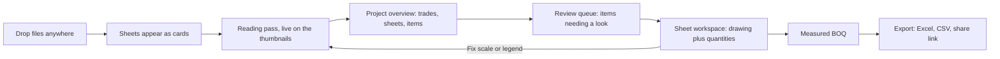
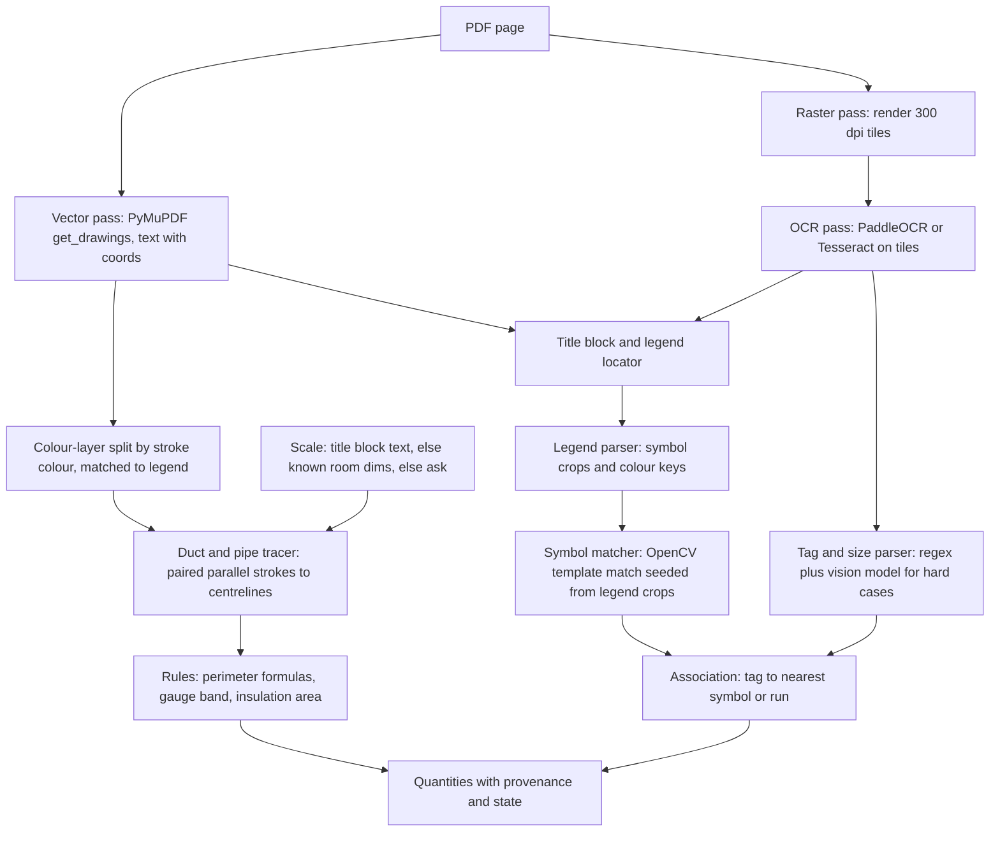

# Preconstruct — MVP Development Plan

**Product:** Preconstruct (part of the Vanik product line; replaces the working name "Vanik Precon")
**Scope:** End-to-end MVP: project intake → drawing upload → automated reading → review → measured BOQ → export, inside a real multi-user SaaS shell.
**Status:** Plan for approval. Nothing below has been built yet.

---

## 0. Corrections to earlier deliverables (please read first)

Re-reading the docs and the Excel sheet before planning, I found problems in my own earlier work. They matter because the MVP would otherwise be tested against them.

> [!WARNING]
> **The HVAC "ground-truth" test datasets are not ground truth.** `pypdf` extracted only room names and short tags (FD1, D3, GL2, LV, C1–C44) from the drawing. The equipment callouts (TR, CFM), duct sizes and counts are AutoCAD SHX text drawn as vector strokes, and I never extracted them. I read a few values off low-resolution crops (e.g. "FF-FA-AHU-05 … PICKLE BALL"), but these numbers were **estimated or invented, not measured**:
> - Capacities/airflows for AHU-01 to AHU-04, all FCU/split/pressurisation-fan data
> - Counts: 64 side-throw grilles, 22 return grilles, 16 exhaust grilles, 10 FDA, 24 FD
> - All duct lengths, the 97 m pipe length, valve packages, unit rates and the $136,345.70 BOQ total
> - The bid-levelling and revision-delta scenarios (made-up examples)

> [!WARNING]
> **Engineering errors:**
> - **Duct formulas contradict each other.** Dataset 2.1 uses the rectangular formula `2(W+H)` for capsule ducts. `ESTIMATING_STANDARDS_SMACNA.md` correctly uses `2(A−B)+πB`.
> - **The gauge table is probably wrong.** As I remember IS 655, the bands are ≤750 mm → 0.63 mm, 751–1000 → 0.80, 1001–1500 → 1.00, 1501–2250 → 1.25. So a 1600 mm duct would be 1.25 mm, not 1.00 mm as I wrote. Someone needs to check this against the standard.

> [!CAUTION]
> **Market and competitor figures were never researched.** That includes the $12.4B TAM, competitor prices, accuracy targets ("99.5%") and ARR projections. The roadmap tab also marks Phase 1 as "COMPLETE", which isn't true. The Excel never got frozen header rows, even though I said it had. Treat the workbook as a draft outline, not research.

**What the plan does about this:** Milestone M0 builds a real, hand-verified annotation set for the Manipal drawing. That becomes the only accuracy benchmark. Market claims get re-sourced before anyone outside the team sees them.

---

## 1. What we keep from the docs

- **Target user for the MVP:** MEP estimators at subcontractors and GCs, working from 2D PDF tender sets. 3D/IFC is a later phase.
- **Core job:** turn a tender drawing into a checked, measured bill of quantities faster than tracing by hand, with every number traceable to the place on the sheet it came from.
- **Ideas to carry over:** the Boon idea of linking schedules to plans, the MeasureBook idea of reading a drawing in layers, the DDC cost-code mapping, and a review loop where a person signs off.
- **Deferred to after the MVP:** bid levelling, WhatsApp field agent, 3D BIM takeoff, ACC/Procore sync, SSO/SCIM.

---

## 2. Product principles (they drive every UX decision)

1. **Review, don't trace.** The machine drafts and the estimator approves. The main screen is a review queue, not an empty canvas.
2. **Every number has a home.** Clicking any quantity shows the exact strokes or symbols it came from. No number appears without that link.
3. **Honest certainty.** Items are marked *Measured* (deterministic geometry), *Read* (text/OCR), or *Needs a look* (inferred). We don't show fake percentages.
4. **Zero setup.** Drop files, nothing else. Discipline, sheet number, scale and legend are detected. The user is only asked when detection fails.
5. **Non-AI-styled.** No sparkles, no purple gradients, no "magic" or "AI is thinking". The UI talks like a senior estimator: *"Read 41 tags · 3 need a look."*

---

## 3. Reimagined user flows

### 3.1 Flow map



### 3.2 Flows

| # | Flow | What the user does | What the system does | Fatigue reducers |
|---|---|---|---|---|
| F1 | **First run** | Signs in and lands on an empty project | Offers a drop zone plus "Open sample: Manipal Sports Complex" | Sample project explores the app with no files |
| F2 | **Intake** | Drops a PDF/ZIP onto the window | Splits pages, renders thumbnails, detects title block, sheet no., discipline, scale | No forms; project name comes from the title block and can be edited inline |
| F3 | **Reading pass** | Watches or leaves | Runs the pipeline per sheet and streams results | Keeps running in the background with a tab-title badge and toast when done |
| F4 | **Overview** | Scans the project | Shows trade stacks, sheet grid and an "N items need a look" banner | One clear next action |
| F5 | **Review queue** | Approves, corrects or rejects with `A` / `E` / `X` | Shows a zoomed crop of each item with the candidate value | Keyboard-only; groups similar items ("12 identical diffusers → approve all") |
| F6 | **Sheet workspace** | Inspects, measures by hand, edits | Two-way hover link between drawing and table | Tools stay out of the way until needed (`L`, `A`, `C`) |
| F7 | **Fix calibration** | Clicks the scale chip | Two-point calibration that suggests known room dimensions | Re-measures affected items and shows a before/after diff |
| F8 | **BOQ and export** | Picks grouping (trade / CSI / zone) and exports | Formatted Excel with a source column (sheet + coordinates) | Export remembers the last settings |
| F9 | **Collaboration (SaaS)** | Invites a reviewer and leaves comments | Workspace roles, an activity log, comment pins on the drawing | Mentions and a "changed since you last looked" marker |

---

## 4. Design language

### 4.1 Direction: neo-minimalism plus compact maximalism

- **Neo-minimalism for the shell:** warm off-white canvas, hairline borders, lots of air around navigation, one accent colour, calm motion.
- **Compact maximalism for the data:** dense tables and cards, strong type-size contrast (big numbers, tiny labels), colour chips per trade, small charts inside cards. Lots of information, organised hard.
- **Rule:** the chrome is quiet so the data can be loud.

### 4.2 Palette, based on Pantone

**Base:** Pantone Colour of the Year 2026 is **Cloud Dancer (PANTONE 11-4201)**. I confirmed this by search.

**Accent:** **Mocha Mousse (PANTONE 17-1230)**, the 2025 colour. It reads like construction material (timber, terracotta) and is not "tech blue".

> [!NOTE]
> Hex values below are screen approximations. Pantone values are print standards.

| Token | Role | Approx. hex | Source |
|---|---|---|---|
| `paper` | App background | `#F0EEE9` | Cloud Dancer 11-4201 |
| `sheet` | Cards, panels | `#FBFAF7` | Lighter tint of Cloud Dancer |
| `ink` | Primary text | `#1F1D1A` | Warm near-black |
| `graphite` | Secondary text | `#6B665E` | Warm grey |
| `rule` | Hairline borders | `#DDD8CF` | Warm grey |
| `mocha` | Primary actions, focus, selection | `#A47864` | Mocha Mousse 17-1230 |
| `mocha-deep` | Hover/pressed, AA-contrast text on `paper` | `#7A5545` | Darker shade; contrast still to be checked |
| `measured` | Measured state | `#3E6B57` | Muted green |
| `read` | Read state | `#3C5A7A` | Muted blue |
| `look` | Needs-a-look state | `#B5832A` | Ochre |
| `void` | Errors | `#A6402F` | Brick |

**Trade chips:** these follow the drawing's own legend colours (supply magenta, return green, fresh-air cyan, exhaust orange, CHW green/olive, drain blue). They are desaturated in the UI, but on the canvas overlays they match the drawing, so the overlay and the legend never disagree.

**Dark mode:** optional and second, using a warm charcoal base (not blue-black).

### 4.3 Type, shape, density

- **Type:**
  - *Inter Tight* for UI.
  - *JetBrains Mono* with tabular numerals for quantities, tags and sizes.
  - Display numbers at 28–40 px and labels at 11 px, uppercase with tracking.
- **Shape:** 6 px radius on cards and 4 px on chips. Hairline 1 px borders instead of shadows; shadows only on floating layers.
- **Density modes:** *Comfortable* and *Compact* (36 px vs 28 px rows), switched with `D`.

### 4.4 Components (reimagined)

- **Sheet card:** thumbnail with a live detection overlay, sheet no. in mono, a discipline chip, and a three-segment bar for measured/read/look counts. Hover scrubs a zoomed preview.
- **Quantity card:** big number with unit, the source sheet, and a sparkline of how the value changed across revisions.
- **Review item:** crop of the drawing (left), candidate value and alternatives (right), and A/E/X keycaps shown inline.
- **Buttons:**
  - Primary is solid mocha.
  - Secondary is a hairline outline.
  - Tertiary is text only.
  - Labels are verbs ("Approve 12", "Export BOQ"), never "Generate ✦".
- **Status chip:** state colour plus an icon plus a word, so it never relies on colour alone.
- **Command bar (`Ctrl+K`):** jump to a sheet, tag or action.

### 4.5 Copy rules

| Instead of | Write |
|---|---|
| "AI is analysing your drawing…" | "Reading sheet 2 of 5 · 214 symbols found" |
| "✦ Generate Takeoff" | "Measure this sheet" |
| "Confidence: 87%" | "Needs a look: scale inferred from room size" |

---

## 5. Motion and microinteractions

| Moment | Animation | Purpose |
|---|---|---|
| File drag-over | The window edge draws a mocha hairline and the drop zone gently "breathes" | Makes clear the whole window is a target |
| Upload | Files fan into a stack, then deal out into sheet cards as pages split; one progress hairline per card | Turns waiting into visible structure |
| Reading pass | A scan band sweeps each thumbnail once per stage (text → lines → symbols → rules); detected items fade in as dots; counters tick up in tabular mono | Shows real progress instead of a spinner |
| Stage complete | The card's three-segment bar fills, then settles | Gives a clear sense of done |
| Row ↔ drawing hover | Linked element outlines in mocha; the canvas eases to it (240 ms) | Keeps the user's place |
| Approve in review | The item slides left, the next one slides in, the queue counter decrements | Rhythm and momentum |
| Calibration change | Affected quantities flash a diff (old struck through → new) | Trust and traceability |
| Export | The button turns into a progress hairline, then into "Open file" | No modal interruption |

**Rules:**
- Durations are 120–240 ms, using one easing curve, `cubic-bezier(.2,.7,.2,1)`.
- `prefers-reduced-motion` swaps sweeps and slides for opacity fades.
- Nothing loops forever except the live reading indicator.

---

## 6. Reading pipeline (algorithms plus models)

A key finding from the real drawing: **text extraction alone misses most annotations**, because the AutoCAD SHX text is drawn as strokes. So the pipeline has to combine vector geometry, OCR on a raster, and model reading.



| Stage | Method | Deterministic? | State it produces |
|---|---|---|---|
| Vector and text | PyMuPDF paths and spans with coordinates | Yes | Read |
| OCR | PaddleOCR or Tesseract on 300 dpi tiles, de-duplicated against vector text | Mostly | Read |
| Legend | Locate the "LEGEND" block; crop symbol cells; map colour → system | Yes, with a model fallback | Read |
| Symbols | Template matching (multi-scale, rotated) seeded from legend crops | Yes | Measured (count) |
| Linear runs | Group parallel strokes of the same colour → centreline polyline → length × scale | Yes | Measured |
| Sizes and tags | Regex (`\d+x\d+`, `Ø\d+`, `AHU-\d+`, `FD\d`) plus nearest-run association | Yes | Read |
| Hard cases | Vision-language model on a cropped region, with a strict JSON schema; output must pass the rule checks | No | Needs a look |
| Rules | Perimeter formulas, gauge band, insulation area | Yes | Measured |

**LLM guardrails:** The model never produces a quantity directly. It only labels or links things the geometry has already found. Anything it alone asserts lands in *Needs a look*.

---

## 7. SaaS shell (MVP level)

- **Accounts:** auth with email magic link and Google; workspaces; roles Owner / Estimator / Reviewer.
- **Projects:** projects → revisions → sheets; activity log; comments pinned to the drawing.
- **Jobs:** a background job queue with progress streamed over SSE.
- **Storage:** object storage for PDFs and tiles; Postgres for data.
- **Plans and limits:** sheet quota per workspace, with a billing stub (Stripe test mode).
- **Not in the MVP:** SSO/SCIM, ACC/Procore, audit export.

---

## 8. Proposed stack and repo layout

| Layer | Choice | Why |
|---|---|---|
| Frontend | Vite + React + TypeScript; vanilla CSS with design tokens | Complex stateful app; tokens map straight to section 4 |
| Canvas | PDF.js for page rendering + a 2D canvas overlay layer | PDF.js already proved it renders this drawing correctly here |
| Table | TanStack Table (MIT) | Avoids an AG Grid Enterprise licence for the MVP |
| Backend | FastAPI (Python 3.12) | Already scaffolded; Python suits the CV/PDF libraries |
| Workers | RQ or Celery + Redis | Per-sheet jobs |
| Extraction | PyMuPDF, OpenCV, PaddleOCR/Tesseract; one vision model behind an adapter | Section 6 |
| Data | Postgres (SQLite for local dev) | |
| Export | openpyxl | Already used |

Rename `c:\rushilProcess\vanik-precon\` to `c:\rushilProcess\preconstruct\` with this layout:

```
preconstruct/
├── apps/web/            # Vite React app (design system, flows)
├── apps/api/            # FastAPI, auth, projects, jobs, export
├── packages/reader/     # extraction pipeline (section 6), CLI-runnable
├── fixtures/manipal/    # drawing + hand-verified annotations (M0)
├── docs/                # architecture, standards (corrected), this plan
└── design/              # tokens.json, component specs, motion specs
```

The current static prototype gets archived under `docs/legacy-prototype/`.

---

## 9. Milestones

| M | Deliverable | Done when |
|---|---|---|
| **M0** | Real benchmark: hand-annotate the Manipal sheet (equipment tags and callouts, symbol counts per legend type, duct runs with sizes); fix the gauge table and duct formulas; flag market data as unverified | Annotation JSON reviewed by you or an HVAC estimator |
| **M1** | Design system: tokens, type, 12 core components, motion specs, light theme; static Storybook-style page | Tokens pass WCAG AA; screenshots approved |
| **M2** | SaaS shell plus intake: auth, workspaces, projects, drag-drop upload with fan/deal animation, page split, thumbnails, title-block detection | Uploading the Manipal PDF gives a named project and a correct sheet card |
| **M3** | Sheet workspace: PDF.js viewer, overlays, manual length/area/count tools, calibration flow, two-way hover link | Manual measurement of a known room (e.g. AHU Room-04, 4950 × 7450) comes out within ±1% |
| **M4** | Reading pipeline v1: vector + OCR + legend + symbol matcher + run tracer + rules; live reading animation via SSE | Precision and recall measured against the M0 benchmark and reported honestly |
| **M5** | Review queue plus BOQ: keyboard review, bulk approve, BOQ grouping, Excel export with provenance column | End-to-end in under 15 min for the sample sheet, timed |
| **M6** | Polish: reduced motion, empty and error states, compact mode, command bar, collaboration comments, sample project | Usability pass with 2–3 estimators |

Accuracy targets get set **after** M4's first measured numbers, not before.

---

## 10. Decisions I need from you

1. **Theme:** light-first on Cloud Dancer/Mocha Mousse (what I recommend for neo-minimalism), or keep the dark theme as the default?
2. **Stack:** is Vite + React + TS acceptable, or must it stay vanilla HTML/JS?
3. **Vision model provider:** which provider/key should the model fallback use? (The API keys audit lists several working ones.)
4. **Benchmark:** can you or an estimator verify the M0 hand annotations? I can draft them from high-resolution crops, but they need a domain check.
5. **Folder:** OK to rename `vanik-precon` → `preconstruct` and archive the current prototype?
