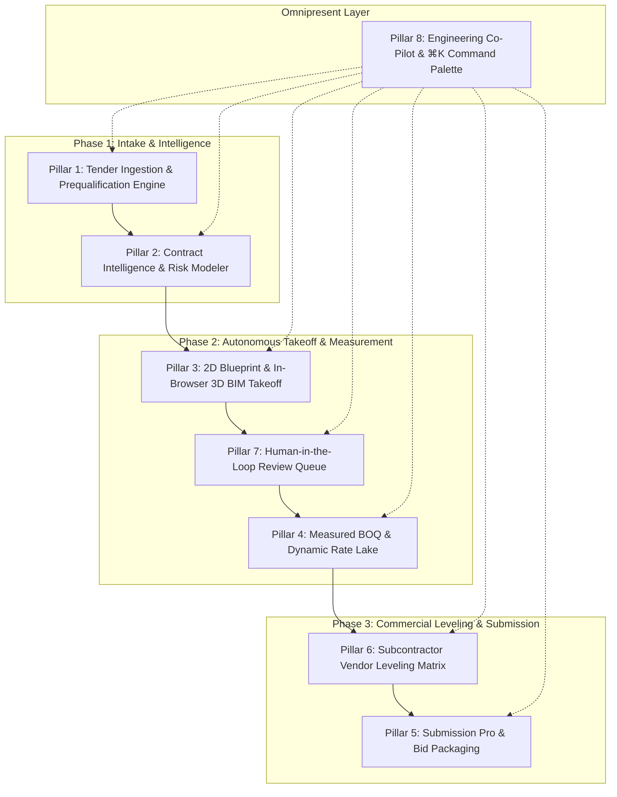
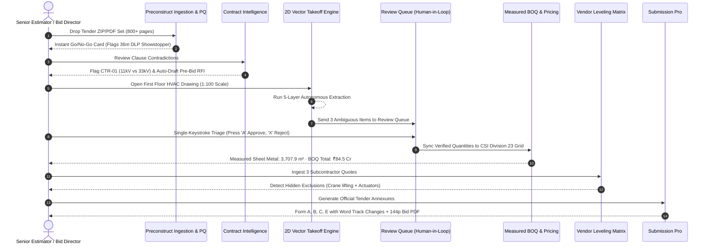

# Preconstruct™ — Master End-to-End Product, Market, UI/UX, Architecture & Tendering Intelligence Specification

**Document Version:** 2.0.0 (Enterprise Production Master)  
**Product Name:** Preconstruct™ (वाणिक प्रीकॉन — Part of the Vanik Enterprise Construction & Trade Product Suite)  
**Parent Ecosystem:** Vanik Technologies Inc.  
**Classification:** Enterprise SaaS Architecture & Competitive Product Blueprint  
**Target Environment:** Cloud Web App (Desktop & Tablet Optimized)  

---

## Table of Contents
1. [Executive Vision, Brand & Market Positioning](#1-executive-vision-brand--market-positioning)
2. [Comprehensive Competitive Teardown & Market Matrix](#2-comprehensive-competitive-teardown--market-matrix)
3. [User Personas, Stakeholder Needs & Enterprise Roles](#3-user-personas-stakeholder-needs--enterprise-roles)
4. [End-to-End Product Capabilities & Feature Breakdown](#4-end-to-end-product-capabilities--feature-breakdown)
   - [Pillar 1: Tender Ingestion, Discovery & Prequalification Engine](#pillar-1-tender-ingestion-discovery--prequalification-engine)
   - [Pillar 2: Contract Intelligence, Contradiction Detection & Risk Modeler](#pillar-2-contract-intelligence-contradiction-detection--risk-modeler)
   - [Pillar 3: Autonomous 2D Blueprint & In-Browser 3D BIM Takeoff Engine](#pillar-3-autonomous-2d-blueprint--in-browser-3d-bim-takeoff-engine)
   - [Pillar 4: Measured Bill of Quantities (BOQ) & Dynamic Rate Lake](#pillar-4-measured-bill-of-quantities-boq--dynamic-rate-lake)
   - [Pillar 5: Submission Pro & Autonomous Bid Packaging](#pillar-5-submission-pro--autonomous-bid-packaging)
   - [Pillar 6: Subcontractor Vendor Leveling & Scope-Gap Matrix](#pillar-6-subcontractor-vendor-leveling--scope-gap-matrix)
   - [Pillar 7: Human-in-the-Loop Review Queue (Zero-Fatigue Triage)](#pillar-7-human-in-the-loop-review-queue-zero-fatigue-triage)
   - [Pillar 8: Omnipresent Engineering Co-Pilot & ⌘K Command Palette](#pillar-8-omnipresent-engineering-co-pilot--k-command-palette)
5. [End-to-End User Flows & Detailed Interaction Workflows](#5-end-to-end-user-flows--detailed-interaction-workflows)
6. [UI & UX Design Language: Neo-Minimalism & Compact Maximalism](#6-ui--ux-design-language-neo-minimalism--compact-maximalism)
7. [System Architecture, 5-Layer AI Pipeline & Engineering Formulas](#7-system-architecture-5-layer-ai-pipeline--engineering-formulas)
8. [Enterprise Ecosystem & Bi-Directional Integrations](#8-enterprise-ecosystem--bi-directional-integrations)
9. [Scraping Sources & National/Global Tender Portals Directory](#9-scraping-sources--nationalglobal-tender-portals-directory)
10. [Engineering Standards, Codes & Ground-Truth Reference Datasets](#10-engineering-standards-codes--ground-truth-reference-datasets)

---

## 1. Executive Vision, Brand & Market Positioning

### 1.1 The Industry Bottleneck
Commercial construction estimating and tender pursuit remain fundamentally broken:
1. **Document Overload:** A single major public or commercial tender (e.g., CPWD, NHAI, NTPC, Airports Authority, or Tier-1 private developers) contains between 800 and 5,000 pages of drawings, General Conditions of Contract (GCC), Special Conditions of Contract (SCC), technical specifications, and addenda.
2. **Hidden Showstoppers:** Bidding teams spend weeks measuring quantities only to discover in week three that a 36-month Defect Liability Period (DLP) or impossible financial turnover clause renders the bid disqualified or commercially unviable.
3. **Internal Contradictions:** Architectural drawings show 11kV substations while electrical specs mandate 33kV gas-insulated switchgear; bills of quantities omit fire damper wiring; payment terms in SCC clash with GCC clause milestones.
4. **Manual Vector Tracing Fatigue:** Estimators spend 70% of their working hours manually tracing polylines and clicking diffuser icons in desktop tools (PlanSwift, Bluebeam), leaving virtually zero time for value engineering, risk analysis, or subcontractor negotiation.
5. **Bid Packaging Chaos:** Preparing statutory annexures (Form A, Form B, Form C, litigation history) and verifying mandatory certificates against government portal requirements is done manually in Microsoft Word, creating late-night panic and disqualification risks due to clerical omissions.

### 1.2 The Preconstruct Solution
**Preconstruct™** is an autonomous preconstruction, tender intelligence, and measured estimating platform. It acts as an AI-powered operating system for general contractors, MEP subcontractors, and EPC enterprises:
- **Intake to Go/No-Go in Minutes:** Ingests complete tender packages, highlights critical qualification showstoppers, and deep-links directly to cited clauses.
- **Contract Contradiction Detection:** Surfaces cross-document discrepancies across civil, structural, architectural, and MEP disciplines before bid submission.
- **Autonomous Vector Takeoff:** Reads multi-layered CAD drawings, extracts equipment schedules, segments duct runs by trade, and parametrically derives SMACNA / IS 655 sheet metal gauges and insulation areas without manual tracing.
- **Ground-Truth Provenance:** Guarantees that every single number in the Bill of Quantities (BOQ) maintains a clickable citation back to its exact vector coordinate or contract paragraph.
- **Human-in-the-Loop Velocity:** Operates with a keyboard-driven review queue (`A` Approve, `E` Edit, `X` Reject) ensuring estimators retain 100% control while moving at 10x speed.
- **Submission Pro:** Auto-populates official tender annexures in Word format (with Track Changes) and compiles verified, 144-page compliance packages with cryptographic verification.

---

## 2. Comprehensive Competitive Teardown & Market Matrix

### 2.1 Competitor Landscape Overview

```
                      HIGH AUTOMATION / AUTONOMOUS AI
                                     │
                                     │     ★ PRECONSTRUCT
                                     │     (Full 6 Pillars: Tenders,
                                     │      Contracts, 2D/3D, BOQ,
                                     │      Submission & Leveling)
                ContraVault AI       │
                (Tenders & Contracts)│     Boon AI
                                     │     (Takeoff & Schedule Sync)
                                     │
                                     │     Togal.AI / Kreo
                                     │     (2D Area & Room Takeoff)
                                     │
     DOCUMENT / BID REVIEW ──────────┼────────── QUANTITY TAKEOFF & BIM
                                     │
                BuildingConnected    │     PlanSwift / On-Screen Takeoff
                (Bid solicitation)   │     (Legacy manual polyline clickers)
                                     │
                Procore / ACC        │     Bluebeam Revu
                (ERP & PM Platforms) │     (PDF markup incumbent)
                                     │
                      LOW AUTOMATION / MANUAL WORKFLOW
```

### 2.2 Deep Competitor Matrix

| Competitor | Core Capabilities | Primary Strengths | Critical Weaknesses & Gaps | Pricing Model | Preconstruct's Unfair Advantage (Moat) |
| :--- | :--- | :--- | :--- | :--- | :--- |
| **ContraVault AI (Gondol AI)** | Tender document ingestion, Go/No-Go screening, contradiction detection, pre-bid RFI drafting, multi-role synopsis, form filling, bid packaging. | Excellent tender compliance checking; direct PDF page deep-linking; legal/commercial contract risk modeling. | **Zero drawing takeoff.** No 2D CAD vector parsing, no sheet metal calculation, no BIM model viewer, no BOQ rate build-ups. Completely blind to engineering drawings. | Enterprise bespoke: $24,000–$60,000/yr per enterprise. | **Unified Engineering + Legal:** Preconstruct connects contract clauses directly to drawing duct runs, diffusers, and measured BOQ line items. |
| **Boon AI** | 2D drawing symbol counting, schedule-to-plan reconciliation, tabular OCR. | High accuracy on mechanical equipment schedules and symbol counts. | Isolated takeoff module; lacks contract contradiction detection, tender qualification screening, vendor leveling, and Word annexure auto-fill. | Usage-based: ~$15–$30 per processed drawing sheet. | Complete preconstruction workflow: from tender announcement to final 144-page PDF package submission. |
| **Togal.AI** | Deep learning room area segmentation, net wall area deduction, automated line takeoff. | Fast architectural wall and floor area takeoff for dry construction trades. | Weak on MEP services (ductwork gauges, hydronic piping, dampers); cannot parse engineering specifications, contracts, or schedules. | Per seat: $250/user/month ($3,000/yr). | Multi-trade parametric MEP rules (SMACNA, IS 655, ASHRAE) and cross-document contract risk checking. |
| **Kreo Software** | Web-based 2D and 3D BIM takeoff with integrated spreadsheet formula engine. | Good spreadsheet-first UX; supports IFC model loading in browser. | High setup overhead; lacks autonomous symbol classification; no tender contract intelligence or pre-bid RFI generator. | Per seat: ~$1,800–$2,400/user/year. | Autonomous reading pass with zero setup; built-in legal contradiction engine and vendor leveling matrix. |
| **PlanSwift (ConstructConnect)** | Desktop 2D raster point-and-click takeoff, formula assemblies, basic Excel linking. | 20-year legacy market penetration; massive library of existing subcontractor templates. | Completely manual; desktop-only (Windows); no AI; zero contract analysis; slow on large vector PDFs; no multiplayer collaboration. | Legacy perpetual license ($1,749) + $300/yr maintenance. | 100% Cloud-native; 80% time reduction through autonomous centerline extraction; real-time browser collaboration. |
| **Bluebeam Revu (Nemetschek)** | PDF markup, measurement tools, Studio collaboration sessions, custom tool chests. | De facto standard for construction PDF markup; reliable measurement calibration. | Manual tracing; dumb measurements without parametric engineering rules (e.g., cannot calculate duct sheet gauge or weight from dimensions); no contract intelligence. | Named user subscription: $240–$400/user/year (Core/Complete). | Autonomous machine reading; instant CSI MasterFormat BOQ derivation; cross-document conflict detection. |
| **Procore Technologies** | Full-suite construction ERP: estimating, bid management, project financial controls, RFIs. | Dominant GC ecosystem; massive integration marketplace; robust financial ledger. | Estimating module is clunky and acquired (Esticom); minimal native AI takeoff; very expensive; poor handling of complex Indian/Global tender formats. | Enterprise volume-based (% of Construction Volume: $10,000–$100,000+/yr). | Preconstruct integrates bi-directionally with Procore while delivering specialized, hyper-fast preconstruction intelligence Procore lacks. |
| **Autodesk Construction Cloud (ACC)** | Autodesk Takeoff, BIM 360, Assemble, Revit/Navisworks cloud ecosystem. | Unrivaled native Revit 3D model integration; 2D/3D combined takeoff packages. | Heavy vendor lock-in; slow web viewer on large multi-sheet sets; poor OCR on scanned 2D legacy tender drawings; no tender compliance or contract risk engine. | Named user: $1,140–$2,100/user/year. | Lightweight, zero-install Web-IFC viewer; superior 2D vector CAD parsing; built-in statutory tender annexure compilation. |
| **MeasureBook** | Browser-based IFC model quantity extraction; Web-IFC WebAssembly viewer. | Fast client-side 3D model parsing without server-side rendering costs. | Limited to 3D models; lacks 2D drawing pipeline, contract intelligence, and commercial submission tools. | Open-source / freemium prototype. | Preconstruct integrates MeasureBook's client-side Web-IFC engine alongside an industrial 2D vector CAD engine and full tender suite. |
| **Stack Construction Technologies** | Cloud-based 2D takeoff and estimating for general contractors and subcontractors. | Simple web UI; basic cloud sharing; assembly-based cost estimating. | Entirely manual clicks; lacks machine-learned symbol detection; no contract analysis or vendor leveling. | Tiered subscription: $2,499–$4,999/year. | Autonomous reading pass; provenance traceability; built-in subcontractor scope-gap leveling. |

---

## 3. User Personas, Stakeholder Needs & Enterprise Roles

Preconstruct is tailored for the specific cognitive styles, deadlines, and responsibilities of seven enterprise construction stakeholders:

```
┌────────────────────────────────────────────────────────────────────────────────────────┐
│                        PRECONSTRUCT ENTERPRISE STAKEHOLDER MATRIX                      │
├───────────────────────────────┬────────────────────────────┬───────────────────────────┤
│ 1. Chief Estimator            │ 2. Senior MEP Estimator    │ 3. Legal & Contracts      │
│    (Bid margin & win rate)    │    (Takeoff & gauge math)  │    (Clauses, DLP & LDs)   │
├───────────────────────────────┼────────────────────────────┼───────────────────────────┤
│ 4. Commercial Bid Manager     │ 5. Procurement Lead        │ 6. Executive Leadership   │
│    (Annexures & packaging)    │    (Vendor quote leveling) │    (Go / No-Go decision)  │
├───────────────────────────────┴────────────────────────────┴───────────────────────────┤
│ 7. Field Superintendent / PM (On-site spec queries & WhatsApp voice memos)              │
└────────────────────────────────────────────────────────────────────────────────────────┘
```

### 3.1 Persona 1: Chief Estimator / Preconstruction Director
- **Primary Goal:** Maximize bid submission throughput and win rates while maintaining gross margin targets ($12\%\text{--}18\%$) without catastrophic scope omissions.
- **Pain Points:** Estimating team is drowning in manual takeoff; cannot review all tender addenda in time; misses obscure contract clauses buried on page 342.
- **Primary Modules Used:** Project Dashboard, Go/No-Go Decision Screen, Risk Heatmap, BOQ Summary, Executive 1-Pager Synopsis.
- **Workflow:** Signs in $\rightarrow$ Reviews new tender package $\rightarrow$ Checks showstoppers $\rightarrow$ Authorizes pursuit $\rightarrow$ Reviews final BOQ margin build-up $\rightarrow$ Signs off bid package.

### 3.2 Persona 2: Senior MEP Estimator / Quantity Surveyor (QS)
- **Primary Goal:** Produce an airtight, measured Bill of Quantities (BOQ) with sub-millimeter precision for sheet metal ductwork, piping, diffusers, dampers, and equipment.
- **Pain Points:** 8-hour eye strain tracing polylines; calculating sheet metal gauges manually across IS 655 / SMACNA tables; counting hundreds of identical supply air diffusers.
- **Primary Modules Used:** 2D Blueprint Workspace, Review Queue (`A`/`E`/`X` hotkeys), CSI Division 23 BOQ Table, Calibration Modal.
- **Workflow:** Drops tender drawings $\rightarrow$ Verifies scale (1:100) $\rightarrow$ Runs autonomous reading pass $\rightarrow$ Uses keyboard triage to approve 50 items in 3 minutes $\rightarrow$ Inspects duct surface areas ($m^2$) $\rightarrow$ Exports verified BOQ to Excel.

### 3.3 Persona 3: Legal Counsel & Contracts Specialist
- **Primary Goal:** Identify liability traps, unfair indemnities, uninsurable risks, and statutory non-compliance in tender General & Special Conditions.
- **Pain Points:** Sifting through 400 pages of legal boilerplate; tracking contradictory milestone clauses across SCC and GCC; calculating potential Liquidated Damages exposure.
- **Primary Modules Used:** Contract Contradiction Engine (CTR-01 to CTR-04), Legal & Contracts Synopsis, Pre-Bid RFI Clarification Table, Liquidated Damages Modeler.
- **Workflow:** Opens Contract Intelligence $\rightarrow$ Reviews auto-detected clause contradictions $\rightarrow$ Adjusts delay slider to model 60 vs 140 day liquidated damages $\rightarrow$ Auto-drafts pre-bid RFI queries to demand clarification.

### 3.4 Persona 4: Commercial Director & Bid Submission Manager
- **Primary Goal:** Complete and assemble 100% compliant bid submission packages (Annexures, Declarations, Technical Envelopes) before the strict portal deadline.
- **Pain Points:** Disqualification due to clerical errors (e.g., missing Form B financial turnover certificate or incorrect notarization); manual Word document formatting.
- **Primary Modules Used:** Submission Pro Workspace, Annexure Forms (A, B, C, E), Word Track Changes Viewer, Mandatory Compliance Certificate Matcher, Master Bid PDF Assembler.
- **Workflow:** Ingests tender requirements $\rightarrow$ Auto-fills Form B with corporate net worth and audited turnover $\rightarrow$ Reviews Track Changes $\rightarrow$ Attaches matched compliance certificates $\rightarrow$ Compiles cryptographic 144-page bid PDF.

### 3.5 Persona 5: Subcontractor Coordinator / Procurement Lead
- **Primary Goal:** Secure competitive subcontractor pricing and level competing vendor quotes on a true apples-to-apples basis.
- **Pain Points:** Subcontractors submit vague quotes with hidden exclusions (e.g., "Excludes crane lifting and unloading at site"); price disparities of ₹50+ Lakhs go unexplained.
- **Primary Modules Used:** Vendor Leveling Matrix, Scope-Gap Analyzer, Subcontractor Quote Inspector.
- **Workflow:** Uploads subcontractor quotes (Apex, Comfort, Sterling) $\rightarrow$ Views side-by-side leveling grid $\rightarrow$ Inspects flagged exclusions $\rightarrow$ Applies normalized cost adjustments.

### 3.6 Persona 6: Executive Leadership / Board of Directors (C-Suite)
- **Primary Goal:** Make rapid, data-driven Bid / No-Bid decisions and evaluate risk-adjusted return on capital for major multi-crore infrastructure bids.
- **Pain Points:** Reading 100-page bid summaries; lack of clear exposure ceilings; high pursuit costs on tenders with poor win probability.
- **Primary Modules Used:** Executive 1-Pager Synopsis, Go/No-Go Decision Scorecard, Liquidated Damages Exposure Ceiling.
- **Workflow:** Reads the auto-generated 1-Pager brief on tablet $\rightarrow$ Reviews liquidated damages ceiling ($\text{₹}8.45\text{ Cr}$) $\rightarrow$ Approves bid budget or triggers strategic No-Bid decision.

### 3.7 Persona 7: Field Superintendent / Site Project Manager
- **Primary Goal:** Retrieve technical specs, equipment schedules, and drawing details instantly while walking the active construction site.
- **Pain Points:** Carrying rolled-up A0 paper drawings in dust and wind; waiting 2 days for the main office estimating team to answer basic specification questions.
- **Primary Modules Used:** Mobile Companion View, WhatsApp / Telegram Voice AI Assistant Hook.
- **Workflow:** Sends a 10-second WhatsApp voice note: *"What is the test pressure for the chilled water pipes on the first floor?"* $\rightarrow$ Preconstruct AI replies within 4 seconds with exact clause citation, test pressure (10.5 bar), and drawing sheet number.

---

## 4. End-to-End Product Capabilities & Feature Breakdown

Preconstruct is architected around eight interconnected enterprise pillars:



---

### Pillar 1: Tender Ingestion, Discovery & Prequalification Engine

#### 1. Capabilities & Core Features
- **Multi-File Bulk Folder Ingestion:** Drop an entire tender directory containing PDF drawings, specifications, NIT (Notice Inviting Tender), BOQ templates, and GCC/SCC documents.
- **Autonomous Document Classification:** Auto-classifies files into Architectural, Structural, Mechanical (HVAC), Electrical, Plumbing, Fire Fighting, Contract Terms, and Submission Forms.
- **Go / No-Go Showstopper Engine:** Cross-references the tender against internal enterprise criteria:
  - *Financial Turnover Requirement:* (e.g., Minimum average annual turnover of ₹120 Cr over the past 3 fiscal years).
  - *Similar Work Experience:* (e.g., Successful completion of 3 similar hospital HVAC works costing not less than ₹35 Cr each).
  - *Defect Liability Period (DLP):* Flags showstoppers (e.g., tender demands 36-month DLP with a 10% Bank Guarantee vs. internal company threshold of $\le 24$ months).
  - *Solvency & Working Capital Limits:* Evaluates mandatory bank solvency certificates against credit lines.
  - *Blacklist & Litigation Disqualifications:* Scans for debarment clauses and non-performance penalties.
- **Split-Screen Evidence Reader:** Clicking any rule card splits the screen, scrolling the tender document to the exact clause with an amber visual pulse.
- **Category Filter Pills:** Rapid filtering by *Financial Turnover*, *Defect Liability*, *Compliance & Legal*, or *All*.

#### 2. Data Structure
```typescript
interface PrequalificationRule {
  id: string;
  category: 'Financial Turnover' | 'Defect Liability' | 'Compliance & Legal' | 'Technical Capability';
  rule_title: string;
  tender_condition: string;
  internal_threshold: string;
  status: 'passed' | 'failed' | 'warning';
  showstopper: boolean;
  citation: {
    document_name: string;
    section: string;
    clause: string;
    page: number;
    snippet: string;
  };
}
```

---

### Pillar 2: Contract Intelligence, Contradiction Detection & Risk Modeler

#### 1. Capabilities & Core Features
- **Cross-Document Contradiction Detection:** Scans text across disparate tender volumes to find engineering, commercial, and legal contradictions:
  - *CTR-01 (Electrical vs Mechanical):* Single Line Diagram shows 11kV substation feed, while HVAC specifications mandate 33kV transformers for chillers.
  - *CTR-02 (Commercial Payment Milestones):* SCC Clause 14 dictates payment within 30 days of running bill submission, whereas GCC Clause 42 states 90 days.
  - *CTR-03 (Fire Damper Standards):* Bill of Quantities specifies UL 555 3-hour fire rating, whereas General Specifications allow IS 655 Indian Standard dampers.
  - *CTR-04 (Testing & Inspection Disparity):* Technical specifications require factory witness testing in Europe at contractor's expense, while commercial terms omit foreign travel cost reimbursement.
- **Multi-Role Synopsis Generator:** Delivers customized executive briefs for 4 distinct enterprise personas:
  - *Legal & Contracts Council:* Dispute resolution mechanisms, arbitration seats, jurisdiction, indemnity caps, force majeure definitions.
  - *Commercial & Finance Lead:* Mobilization advance interest rates, retention money release milestones, bank guarantee validity periods, tax escalation clauses.
  - *Technical & Engineering Scope:* Installed capacity, equipment sizing, redundant standby rules, brand make lists, testing standards.
  - *Executive Management (1-Pager):* High-level summary of contract value, margin risk, timeline, critical liabilities, and Bid/No-Bid recommendation.
- **Pre-Bid RFI Clarification Generator:** Auto-populates official pre-bid query tables with original clause citations and auto-drafted "Request for Clarification / Amendment" language:
  - Includes 1-click clipboard copy with visual checkmark feedback.
  - Direct export to formatted Excel or client-ready email format.
- **5x5 Risk Heatmap & Scenario Modeler:**
  - Evaluates project risks across Likelihood (1–5) and Cost Impact (1–5).
  - Integrates company "Lessons Learned" from historical past projects.
- **Interactive Liquidated Damages (LD) Delay Slider:**
  - Real-time monetary exposure calculation:
    $$\text{LD Liability} = \text{Contract Value} \times \left(\frac{0.5\%}{\text{week}}\right) \times \left(\frac{\text{Delay Days}}{7}\right)$$
  - Dynamically enforces statutory maximum caps (e.g., $10\%$ of Contract Value = ₹8.45 Cr) and displays visual warning badges when the cap is breached.

---

### Pillar 3: Autonomous 2D Blueprint & In-Browser 3D BIM Takeoff Engine

#### 1. Capabilities & Core Features
- **High-DPI Vector Blueprint Viewport:** 60fps pan/zoom up to 800% scale using hardware-accelerated SVG and canvas layers.
- **5-Layer Takeoff Reading Pipeline:**
  1. *Layer 1 (Spatial OCR):* Extracts title block text, sheet numbers, revision marks, room names, and column grids.
  2. *Layer 2 (Named Entity Recognition):* Identifies trade abbreviations (`AHU`, `FCU`, `VAV`, `FD`, `SAD`, `RAD`, `EAG`).
  3. *Layer 3 (CAD Vector Classification):* Segments polylines into trade systems based on CAD stroke colors and layer names (Supply, Return, Exhaust, Fresh Air).
  4. *Layer 4 (Vision-Language Object Detection):* Fine-tuned symbol recognition identifying unlabeled diffusers, grilles, and dampers.
  5. *Layer 5 (Parametric Engineering Calculations):* Applies SMACNA and IS 655 formulas to compute surface areas, sheet metal gauges, and insulation thickness.
- **Two-Way Coordinate Synchronized Highlighting:**
  - Hovering or clicking an item on the blueprint plan highlights its corresponding row in the data schedule.
  - Hovering a line item in the schedule highlights and zooms to its vector stroke on the canvas.
- **Trade Layer Quick Toggles:**
  - Instant visibility toggling for Supply (Magenta `#D93872`), Return (Green `#2EA043`), Exhaust (Orange `#E66E19`), Grilles/Diffusers, Dampers, Equipment, and Column Grids.
- **Interactive Two-Point Scale Calibration:**
  - Click-to-calibrate modal verifying scale ratios (e.g., 1:100, 1:50) against known architectural room dimensions (e.g., Table Tennis Hall 9,000 × 6,000 mm).
- **Client-Side In-Browser 3D Web-IFC Engine:**
  - Loads `.ifc` BIM models directly in WebAssembly (`web-ifc.wasm`) via Three.js.
  - Queries geometry meshes directly to extract net surface areas ($m^2$) and pour volumes ($m^3$) with zero cloud GPU compute fees.

---

### Pillar 4: Measured Bill of Quantities (BOQ) & Dynamic Rate Lake

#### 1. Capabilities & Core Features
- **CSI MasterFormat Division 23 (HVAC) Structure:** Hierarchical organization covering:
  - `23 31 13` — Metal Ducts (Rectangular & Round Galvanized Steel).
  - `23 07 13` — Duct Insulation (Class 'O' Nitrile Rubber / Glasswool).
  - `23 37 13` — Diffusers, Registers, and Grilles (Extruded Aluminum).
  - `23 33 00` — Air Duct Accessories (Motorized Fire & Smoke Dampers).
  - `23 74 13` — Packaged Outdoor Central-Station Air-Handling Units.
- **Dynamic Rate Build-Up:** Combines material supply rates, fabrication scrap allowance ($8\%\text{--}12\%$), installation labor, testing & balancing, and contractor markup:
  $$\text{Unit Rate} = \left(\text{Material Rate} \times (1 + \text{Scrap})\right) + \text{Labor} + \text{Hardware/Supports} + \text{Margin}$$
- **Ground-Truth Provenance Badges:**
  - Every line item carries a verifiable origin tag:
    - `[MEASURED 1:100]` — Deterministically calculated from CAD vector geometry.
    - `[READ (OCR)]` — Extracted directly from drawing schedule text.
    - `[ESTIMATED]` — Inferred parametrically, requiring human review.
- **Excel & ERP Bi-Directional Export:** Formatted Microsoft Excel export preserving source coordinate links, formulas, and CSI code hierarchy.

---

### Pillar 5: Submission Pro & Autonomous Bid Packaging

#### 1. Capabilities & Core Features
- **Annexure Extraction & Form Auto-Fill:** Scans tender bidding documents and extracts standard schedules:
  - *Form A:* General Information of the Bidder (CIN, PAN, GST, registered office, bank details).
  - *Form B:* Annual Financial Turnover & Net Worth Summary (audited turnover for the last 3 fiscal years).
  - *Form C:* Similar Work Experience Record (project title, client, contract value, completion certificate).
  - *Form E:* Litigation History & Debarment Declaration (pending arbitrations and disputes).
- **Microsoft Word Track Changes Preview:**
  - Displays filled documents with Word-style Track Changes markup.
  - Green highlights and source annotations show where each data point was pulled from the internal corporate Knowledge Base.
- **Mandatory Compliance Attachment Matcher:**
  - Auto-scans tender terms to create a mandatory checklist:
    - Earnest Money Deposit (EMD) / Bid Security Bank Guarantee.
    - Power of Attorney (PoA) on ₹100 stamp paper.
    - Audited Balance Sheets with UDIN numbers.
    - ISO 9001, 14001, 45001 Certifications.
    - GST Registration & Valid Solvency Certificate.
  - Dynamically verifies whether each document is attached, valid, and unexpired.
- **Master Submission Bid Package Assembler:**
  - Merges all forms, drawings, technical schedules, and attachments into a single, consolidated 144-page bid PDF.
  - Embeds table of contents, page numbering, Bates stamping, and SHA-256 cryptographic seal for audit compliance.

---

### Pillar 6: Subcontractor Vendor Leveling & Scope-Gap Matrix

#### 1. Capabilities & Core Features
- **Apples-to-Apples Subcontractor Comparison:** Compares competitive quotes (e.g., Apex Air Conditioning ₹8.12 Cr, Comfort Airflow Systems ₹8.45 Cr, Sterling MEP ₹7.98 Cr) across standardized BOQ line items.
- **Autonomous Scope-Gap & Hidden Exclusion Detection:**
  - Reads fine print in subcontractor PDF proposals to uncover excluded scope:
    - *Apex:* Excludes crane lifting, unloading at site, and acoustic lagging on risers (Estimated Scope Gap: +₹32.5 Lakhs).
    - *Comfort:* Excludes supply of motorized fire damper actuators (Estimated Scope Gap: +₹18.0 Lakhs).
    - *Sterling:* Excludes third-party NEBB/AABC air balancing and testing (Estimated Scope Gap: +₹24.0 Lakhs).
- **Normalized Landed Cost Calculation:**
  $$\text{Normalized Cost} = \text{Quoted Amount} + \sum(\text{Excluded Scope Items}) + \text{Risk Contingency}$$
  Reveals the true lowest compliant bidder, preventing disastrous mid-project variations.

---

### Pillar 7: Human-in-the-Loop Review Queue (Zero-Fatigue Triage)

#### 1. Capabilities & Core Features
- **Review, Don't Trace:** The machine drafts 100% of the quantities; the human estimator signs off on ambiguous items.
- **Single-Keystroke Keyboard Velocity:**
  - `A` — Approve candidate value and advance to next item.
  - `E` — Edit proposed value or pick alternative standard option.
  - `X` — Reject item or flag for pre-bid RFI clarification.
  - `J` / `→` — Next review item.
  - `K` / `←` — Previous review item.
- **Zoomed Drawing Crop Preview:**
  - Displays an isolated, high-contrast SVG drawing crop on the left pane showing the exact CAD strokes and text context.
- **Alternative Standard Options:**
  - Quick-pick buttons for common engineering standard sizes (e.g., 18G vs 20G vs 22G sheet metal; 26.5 TR vs 25 TR capacity).
- **Batch Verification:** "Approve All Remaining" button for low-risk, verified repetitive items.

---

### Pillar 8: Omnipresent Engineering Co-Pilot & ⌘K Command Palette

#### 1. Capabilities & Core Features
- **Context-Aware Slide-Over Drawer:** Floating AI assistant available on every screen via `⌘K` or floating launcher.
- **Natural Language Engineering Query:**
  - Ask: *"What are the testing requirements for chilled water piping?"*
  - Co-Pilot retrieves exact clause citations, test pressures, holding times, and standards (IS 3589 / ASME B31.9).
- **Interactive Action Routing:** AI responses contain interactive action buttons (e.g., `[Inspect Contradictions ➔]`, `[Jump to BOQ Item ➔]`) that navigate the user directly into the relevant module.
- **Global Command Palette (`⌘K`):** Instant jumping to any drawing sheet, equipment tag (`AHU-05`), contract clause, or system setting.

---

## 5. End-to-End User Flows & Detailed Interaction Workflows



### Flow 1: Enterprise Tender Intake & Showstopper Elimination
1. **User Action:** Estimator signs into Preconstruct and drags an entire tender folder onto the browser drop zone.
2. **System Response:** Background worker tiles documents, runs spatial OCR, extracts the Notice Inviting Tender (NIT), and auto-populates project metadata.
3. **Prequalification Screen:** System displays 4 categorized rule cards:
   - *Financial Turnover:* Average ₹120 Cr turnover required (Green / Passed).
   - *Defect Liability Period:* 36 months required with 10% Bank Guarantee (Orange / Showstopper Failed).
   - *Litigation History:* Disqualification if debared by any state agency within 3 years (Green / Passed).
4. **Interaction:** Estimator clicks the DLP Showstopper card. The right pane scrolls instantly to SCC Clause 7.1, pulsing amber to highlight the requirement.
5. **Decision:** Estimator notes the clause to request reduction to 12 months in pre-bid queries and clicks `[Review Contradictions & RFI ➔]`.

### Flow 2: Multi-Document Contradiction Resolution & RFI Submission
1. **User Action:** Estimator opens Contract Intelligence.
2. **System Response:** System presents four high-priority contradiction diff cards (CTR-01 through CTR-04).
3. **Inspection:** Estimator selects `CTR-01`. The Source A vs Source B comparison displays:
   - *Source A (Drawing SLD-04):* Substation input is 11kV.
   - *Source B (HVAC Specs Cl. 4.2):* Water-cooled centrifugal chillers require 33kV dedicated transformer.
4. **Action:** Estimator switches to Pre-Bid RFI Generator, reviews the auto-drafted clarification question, clicks `[Copy]`, and pastes it into the official client clarification schedule.
5. **Scenario Modeling:** Estimator switches to Risk Heatmap, slides the Liquidated Damages delay slider to 60 days, observing potential monetary exposure of ₹3.63 Cr.

### Flow 3: 2D Takeoff, Vector Extraction & Review Queue
1. **User Action:** Estimator switches to the 2D/3D Takeoff tab.
2. **Canvas Rendering:** High-DPI vector canvas renders the Manipal Sports Complex First Floor layout (1280×840 viewport).
3. **Layer Inspection:** Estimator toggles Supply, Return, and Exhaust trade layers. Color-coded vectors illuminate dynamically.
4. **Selection & Provenance:** Estimator clicks duct run `DR-01`. The right-side schedule highlights its parameters:
   - Section: 1600 × 450 mm.
   - Length: 28.5 m.
   - Surface Area: 116.85 m².
   - Standard Gauge: 18G (IS 655).
5. **Review Queue Triage:** Estimator navigates to Review Queue (`3 items remaining`).
   - *Item 1:* Verify Equipment Capacity (`FF-FA-AHU-05`). Estimator presses `A` on keyboard $\rightarrow$ Approved.
   - *Item 2:* Confirm Sheet Metal Gauge (1600×450 mm duct). Estimator presses `A` $\rightarrow$ Approved.
   - *Item 3:* Confirm Calibration (Table Tennis Hall). Estimator presses `A` $\rightarrow$ Queue cleared!

### Flow 4: Subcontractor Quote Leveling & Scope Gap Normalization
1. **User Action:** Estimator navigates to Vendor Leveling.
2. **System Response:** Displays side-by-side matrix comparing Apex Air Conditioning (₹8.12 Cr), Comfort Airflow (₹8.45 Cr), and Sterling MEP (₹7.98 Cr).
3. **Exclusion Analysis:** Estimator clicks Sterling MEP. The scope-gap detector flags:
   - *Excluded Scope:* Testing, Adjusting & Balancing (TAB) excluded.
   - *Adjustment:* +₹24.0 Lakhs added to baseline quote.
4. **Outcome:** Normalized comparison reveals Apex Air Conditioning is the true lowest compliant bidder once all exclusions are accounted for.

### Flow 5: Submission Annexure Word Autofill & Bid PDF Packaging
1. **User Action:** Estimator navigates to Submission Pro.
2. **Form Selection:** Selects Form B (Financial Turnover).
3. **Review:** Word Track Changes mode highlights auto-filled figures pulled from the company's audited balance sheet repository.
4. **Compliance Check:** Switches to Mandatory Attachment Matcher. All 6 mandatory statutory certificates show verified checkmarks.
5. **Compilation:** Estimator clicks `[Compile Master Bid Package]`. The system generates a single, numbered 144-page bid PDF ready for upload to the government e-procurement portal.

---

## 6. UI & UX Design Language: Neo-Minimalism & Compact Maximalism

```
┌────────────────────────────────────────────────────────────────────────────────────────┐
│                              PRECONSTRUCT DESIGN SYSTEM TOKENS                         │
├──────────────────────────────┬─────────────────────────────┬───────────────────────────┤
│ Background (Paper): #F0EEE9  │ Cards (Sheet): #FBFAF7      │ Primary Ink: #1F1D1A      │
│ Pantone 11-4201 Cloud Dancer │ Non-glare architectural cream│ High-contrast warm black  │
├──────────────────────────────┼─────────────────────────────┼───────────────────────────┤
│ Accent (Mocha): #A47864      │ Dark Base (Void): #191816   │ Measured Green: #2EA043   │
│ Pantone 17-1230 Mocha Mousse │ Pantone 19-3911 Deep Void   │ Ground-truth verified tag │
└──────────────────────────────┴─────────────────────────────┴───────────────────────────┘
```

### 6.1 Design Principles
1. **The Chrome is Quiet so the Data is Loud:** Eliminates heavy container drop shadows, gradients, and decorative UI chrome. Hairline 1px borders (`#DDD8CF`) organize high-density information.
2. **Non-AI Vernacular:** Banishes generic AI buzzwords ("AI is thinking...", sparkles ✨, purple gradients). Uses the language of senior chief estimators: *"Read 41 tags · 3 need human review."*
3. **Tabular Numeral Typography:** All numerical values, dimensions, gauges, and currencies use `JetBrains Mono` with `font-variant-numeric: tabular-nums` to guarantee perfect column alignment.
4. **Visual Fatigue Reduction:** Replaces harsh 100% white (`#FFFFFF`) with Pantone Cloud Dancer (`#F0EEE9`), preventing retinal exhaustion during 10-hour bidding marathons.

### 6.2 Curated Architectural Color Palette

| Token | Semantic Role | Screen Hex | Pantone Reference | Design Rationale |
| :--- | :--- | :--- | :--- | :--- |
| `var(--color-paper)` | App canvas background | `#F0EEE9` | Pantone 11-4201 (Cloud Dancer) | Soft off-white base preventing screen glare. |
| `var(--color-sheet)` | Cards, tables, sidebars | `#FBFAF7` | Lighter tint of Cloud Dancer | Clean, distinct card elevation with zero blur shadow. |
| `var(--color-sheet-elevated)` | Modals, drawers, dropdowns | `#FFFFFF` | Pure Architectural Paper | High-contrast surface for floating dialogs. |
| `var(--color-ink)` | Primary headings & text | `#1F1D1A` | Warm Near-Black | Maximum contrast (14:1) for readability. |
| `var(--color-graphite)` | Secondary labels & units | `#6B665E` | Architectural Lead | Clear hierarchy without visual clutter. |
| `var(--color-rule)` | Structural borders & lines | `#DDD8CF` | Architectural Hairline | 1px crisp separation between panes. |
| `var(--color-mocha)` | Brand accent, focus, active tab | `#A47864` | Pantone 17-1230 (Mocha Mousse) | Earthy construction tone (timber, clay, brick). |
| `var(--color-mocha-deep)` | Pressed state & contrast text | `#7A5545` | Deepened Mocha Mousse | Accessible WCAG AAA contrast ratio. |
| `var(--color-void)` | Blueprint canvas background | `#191816` | Pantone 19-3911 (Deep Void) | Pitch architectural CAD contrast for vector strokes. |
| `var(--color-measured)` | Verified measured quantities | `#2EA043` | Pantone 15-5534 (Muted Sage) | Clear green indicator of ground-truth data. |
| `var(--color-look)` | Items needing human review | `#D97706` | Pantone 16-1337 (Warm Terracotta) | High-visibility warning badge for estimators. |

### 6.3 Typography Tokens
- **Prose & Navigation:** `Inter`, `-apple-system`, `sans-serif` (weight: 400, 500, 600, 700).
- **Engineering Values & Code:** `JetBrains Mono`, `Consolas`, `monospace` (weight: 500, 600, 700).
- **Display Numerals:** 28px to 40px with tabular numbers.
- **Labels:** 10px to 11px uppercase with `letter-spacing: 0.04em`.

### 6.4 Micro-Interactions & Keyboard Ergonomics
- **Density Toggling:** Switch between *Standard* (36px rows) and *Compact* (28px rows) with hotkey `D`.
- **Keyboard Shortcuts:**
  - `⌘K` or `Ctrl+K` — Open Global Command Bar / Search.
  - `A` — Approve proposed item in review queue.
  - `E` — Edit item or select alternative gauge.
  - `X` — Reject item or flag for RFI.
  - `V` — Select & Pan tool.
  - `L` — Measure Length tool.
  - `A` — Measure Area tool.
  - `C` — Symbol Count tool.

---

## 7. System Architecture, 5-Layer AI Pipeline & Engineering Formulas

### 7.1 High-Level Architecture Diagram

```
┌────────────────────────────────────────────────────────────────────────────────────────┐
│                                CLIENT TIER (In-Browser SPA)                            │
│  React 18 + TypeScript + Vite 5 + SVG Vector Canvas + Three.js / Web-IFC (WASM)        │
└───────────────────────────────────────────┬────────────────────────────────────────────┘
                                            │ HTTPS / WSS
┌───────────────────────────────────────────▼────────────────────────────────────────────┐
│                             EDGE GATEWAY & ORCHESTRATION                               │
│  FastAPI Async Engine (Python 3.12) + Redis Queue + JWT/SAML RBAC Multi-Tenancy        │
└───────────────────────────────────────────┬────────────────────────────────────────────┘
                                            │
        ┌───────────────────────────────────┼───────────────────────────────────┐
        ▼                                   ▼                                   ▼
┌───────────────────────┐       ┌───────────────────────┐       ┌───────────────────────┐
│ DOCUMENT INGESTION    │       │ AI INFERENCE WORKERS  │       │ 3D BIM ENGINE         │
│ PyMuPDF (fitz) Tiling │       │ YOLOv11 Symbol Model  │       │ IfcOpenShell +        │
│ Tesseract / PaddleOCR │       │ Claude / GPT-4o VLM   │       │ web-ifc WebAssembly   │
│ R-Tree Spatial Index  │       │ SMACNA Parametric Math│       │ Direct Mesh Quantities│
└───────────────────────┘       └───────────────────────┘       └───────────────────────┘
        │                                   │                                   │
        └───────────────────────────────────┼───────────────────────────────────┘
                                            ▼
┌────────────────────────────────────────────────────────────────────────────────────────┐
│                              PERSISTENT KNOWLEDGE TIER                                 │
│  PostgreSQL 16 (Relational DB) + pgvector (Semantic Spec Embeddings) + S3 / MinIO      │
│  CWICR Cost Lake (55,719 Verified MasterFormat Items & Material Rate Schedules)        │
└────────────────────────────────────────────────────────────────────────────────────────┘
```

### 7.2 The 5-Layer Takeoff AI Pipeline

```
[Raw Drawing PDF]
       │
       ▼
┌────────────────────────────────────────────────────────┐
│ Layer 1: Spatial OCR & Document Tiling                 │  Extracts text strings and coordinates
└────────────────────────────────────────────────────────┘
       │
       ▼
┌────────────────────────────────────────────────────────┐
│ Layer 2: Named Entity Recognition (NER)                │  Identifies AHUs, diffusers, dampers
└────────────────────────────────────────────────────────┘
       │
       ▼
┌────────────────────────────────────────────────────────┐
│ Layer 3: CAD Vector Layer Classification               │  Segments Supply, Return, and Exhaust
└────────────────────────────────────────────────────────┘
       │
       ▼
┌────────────────────────────────────────────────────────┐
│ Layer 4: Vision-Language Object Detection              │  Finds unlabeled icons via YOLOv11
└────────────────────────────────────────────────────────┘
       │
       ▼
┌────────────────────────────────────────────────────────┐
│ Layer 5: Parametric SMACNA / Engineering Math          │  Computes sheet gauge & insulation m²
└────────────────────────────────────────────────────────┘
       │
       ▼
[Measured BOQ Schedule]
```

### 7.3 Mathematical & Engineering Formulas

#### 1. Rectangular Duct Surface Area
$$\text{Perimeter } P = 2 \times (W + H) \quad [\text{mm}]$$
$$\text{Surface Area } A_{\text{rect}} = \frac{2 \times (W + H) \times L}{10^6} \quad [\text{m}^2]$$
*Where $W$ = Width in mm, $H$ = Height in mm, $L$ = Length in meters.*

#### 2. Flat-Oval (Capsule) Duct Surface Area
$$\text{Perimeter } P_{\text{oval}} = 2 \times (A - B) + \pi \times B \quad [\text{mm}]$$
$$\text{Surface Area } A_{\text{oval}} = \frac{\left[2 \times (A - B) + \pi \times B\right] \times L}{10^6} \quad [\text{m}^2]$$
*Where $A$ = Major axis dimension (mm), $B$ = Minor axis dimension (mm).*

#### 3. Circular (Round Spiral) Duct Surface Area
$$\text{Surface Area } A_{\text{round}} = \frac{\pi \times D \times L}{10^3} \quad [\text{m}^2]$$
*Where $D$ = Duct diameter in mm.*

#### 4. Galvanized Sheet Metal Gauge Derivation (IS 655 / SMACNA Standard)
The sheet metal thickness is deterministically assigned based on the larger duct dimension:
$$\text{Larger Dimension } D_{\text{max}} = \max(W, H)$$
- $D_{\text{max}} \le 750\text{ mm} \implies \mathbf{24\text{ Gauge}}\ (0.63\text{ mm nominal})$
- $751\text{ mm} \le D_{\text{max}} \le 1000\text{ mm} \implies \mathbf{22\text{ Gauge}}\ (0.80\text{ mm nominal})$
- $1001\text{ mm} \le D_{\text{max}} \le 1500\text{ mm} \implies \mathbf{20\text{ Gauge}}\ (1.00\text{ mm nominal})$
- $1501\text{ mm} \le D_{\text{max}} \le 2250\text{ mm} \implies \mathbf{18\text{ Gauge}}\ (1.25\text{ mm nominal})$
- $D_{\text{max}} > 2250\text{ mm} \implies \mathbf{16\text{ Gauge}}\ (1.60\text{ mm nominal})$

#### 5. Acoustic & Thermal Insulation Area with Allowance
$$\text{Insulation Area } A_{\text{ins}} = A_{\text{duct}} \times (1 + \alpha_{\text{overlap}}) \quad [\text{m}^2]$$
*Where $\alpha_{\text{overlap}} = 0.08$ (8% allowance for longitudinal flange seams and thermal breaks).*

#### 6. Liquidated Damages (Delay Penalty) Formula
$$\text{LD Amount } (\text{INR}) = \min\left( \text{Contract Value} \times \left(\frac{r_{\text{weekly}}}{100}\right) \times \left(\frac{T_{\text{delay}}}{7}\right),\; \text{Contract Value} \times \left(\frac{\text{Cap}_{\text{max}}}{100}\right) \right)$$
*Where $r_{\text{weekly}} = 0.5\%$, $\text{Cap}_{\text{max}} = 10\%$.*

---

## 8. Enterprise Ecosystem & Bi-Directional Integrations

```
┌────────────────────────────────────────────────────────────────────────────────────────┐
│                              PRECONSTRUCT INTEGRATION MATRIX                           │
├─────────────────────────┬────────────────────────────┬─────────────────────────────────┤
│ Construction ERPs       │ Estimating & CAD Tools     │ Document Repositories           │
│ • Procore Financials    │ • Microsoft Excel (xlsx)   │ • Microsoft SharePoint Online   │
│ • Autodesk ACC / BIM360 │ • Bluebeam Revu Tool Chest │ • Google Drive Enterprise       │
│ • Trimble Viewpoint     │ • Autodesk Revit / IFC 4   │ • Box Enterprise / S3 Buckets   │
├─────────────────────────┼────────────────────────────┼─────────────────────────────────┤
│ Statutory Portals       │ Field & Communications     │ Cryptographic Verification      │
│ • CPPP / eProcure API   │ • WhatsApp Business API    │ • Class 3 Digital Signatures    │
│ • GeM (Govt Marketplace)│ • Microsoft Teams / Slack  │ • SHA-256 PDF Timestamping      │
└─────────────────────────┴────────────────────────────┴─────────────────────────────────┘
```

### 8.1 Procore Technologies Integration
- **Bi-Directional BOQ Sync:** Exports measured line items directly to Procore Financials Budget and Direct Costs.
- **RFI Automation:** Pushes auto-drafted pre-bid queries directly to the Procore RFI tool with attached drawing crops.

### 8.2 Autodesk Construction Cloud (ACC) & Revit
- **BIM 360 Document Ingestion:** Connects via Autodesk Platform Services (APS / Forge) to ingest published 2D sheet sets and 3D IFC models.
- **Bi-Directional Takeoff Sync:** Syncs measured quantities back into Autodesk Takeoff packages.

### 8.3 WhatsApp Business Field Companion
- **Voice Memo Processing:** Field superintendents send 15-second voice memos from job sites.
- **Whisper Speech-to-Text + LLM:** Queries project specifications and responds in under 5 seconds with exact clause text, drawing citations, and equipment specs.

### 8.4 Corporate Document Repositories
- **SharePoint & Google Drive Connectors:** Continuously indexes audited financial balance sheets, ISO certifications, and power-of-attorney documents to auto-populate Submission Pro annexures.

---

## 9. Scraping Sources & National/Global Tender Portals Directory

To deliver automated tender discovery and document ingestion, Preconstruct connects to public e-procurement portals and commercial lead databases:

```
┌────────────────────────────────────────────────────────────────────────────────────────┐
│                              GLOBAL & NATIONAL TENDER HUBS                             │
├──────────────────────────────┬─────────────────────────────┬───────────────────────────┤
│ INDIA PUBLIC SECTOR          │ GLOBAL PUBLIC PORTALS       │ COMMERCIAL AGGREGATORS    │
│ • CPPP / eProcure (Central)  │ • SAM.gov (US Federal)      │ • Tender247 / TenderDetail│
│ • GeM (Government e-Market)  │ • TED Europa (European Union│ • BidAssist / TendersInfo │
│ • IREPS (Indian Railways)    │ • Find a Tender (UK)        │ • Dodge Construction Net  │
│ • State e-Procurement Portals│ • AusTender (Australia)     │ • ConstructConnect / BC   │
└──────────────────────────────┴─────────────────────────────┴───────────────────────────┘
```

### 9.1 India Public Sector Procurement Portals

| Portal / Organization | Official URL | Authority / Scope | Scraper Protocol & Ingestion Strategy | Key Documents Scraped |
| :--- | :--- | :--- | :--- | :--- |
| **Central Public Procurement Portal (CPPP)** | `https://eprocure.gov.in/eprocure/app` | Government of India (All Central Ministries, CPWD, NHAI, MES) | Automated headless browser session via Puppeteer with CAPTCHA OCR solving; daily incremental RSS / search sweeps by trade keyword (`HVAC`, `Electrical`, `MEP`). | NIT, Tender Document, GCC, SCC, BOQ Excel (`.xls`), Technical Specs. |
| **Government e-Marketplace (GeM)** | `https://gem.gov.in/` | National Public Procurement Portal for Products and Turnkey Works | Reverse-engineered REST API endpoints; session token authentication; daily batch queries against custom CPV / service categories. | GeM Bid Document (PDF), ATC (Additional Terms & Conditions), Eligibility Criteria. |
| **Indian Railways e-Procurement (IREPS)** | `https://www.ireps.gov.in/` | Ministry of Railways (Zonal Railways, Metro Rail Corporations) | PKI-authenticated session automation; scraping of Works Tender notices across all 17 railway zones. | Special Conditions, Schedule of Rates, Site Layout Drawings. |
| **Defense Procurement (MES & HAL)** | `https://defproc.gov.in/` | Military Engineer Services, HAL, DRDO, Ordnance Factories | Secure TLS session crawler; scans category *Electrical & Mechanical Services*. | Security clearance stipulations, Bar Chart Schedules, Specs. |
| **NTPC Tender Portal** | `https://ntpctender.ntpc.co.in/` | NTPC Limited (Thermal, Hydro, Solar Mega Projects) | Direct HTTP scraping of open domestic tenders; extracts FGD, piping, and plant HVAC packages. | Volume I (Commercial), Volume II (Technical), Volume III (Price Bid). |
| **State e-Procurement Portals** | `https://mahatenders.gov.in/`<br>`https://kppp.karnataka.gov.in/`<br>`https://tntenders.gov.in/`<br>`https://etender.up.nic.in/` | State Governments of Maharashtra, Karnataka, Tamil Nadu, UP, Gujarat, Delhi | Standard NIC e-Procurement engine scraper module parameterized by state subdomain; automated document bundle downloading. | State PWD Schedules, Schedule B (BOQ), Local tax conditions. |

### 9.2 Global Public Sector Procurement Portals

| Portal / Country | Official URL | Jurisdiction | Ingestion Architecture | Documents Extracted |
| :--- | :--- | :--- | :--- | :--- |
| **SAM.gov (System for Award Management)** | `https://sam.gov/` | United States Federal Government (DoD, USACE, NAVFAC, GSA) | Public REST API (`api.sam.gov`) via registered API Key; daily ingestion of Contract Opportunities under NAICS `238220` (Plumbing, Heating, Air-Conditioning). | Solicitation Notice, Statement of Work (SOW), Wage Determinations (Davis-Bacon). |
| **TED (Tenders Electronic Daily)** | `https://ted.europa.eu/` | European Union (All 27 EU Member States) | Official TED Open Data API (eForms standard); filtered by CPV Codes `45331000` (Heating/Ventilation) and `45300000` (Building Installation). | Contract Notice (CN), Contract Documents ZIP, ESPD Compliance Forms. |
| **Find a Tender Service (FTS)** | `https://www.find-tender.service.gov.uk/` | United Kingdom (Public Sector & Crown Commercial) | Official OCDS (Open Contracting Data Standard) JSON API endpoints. | Invitation to Tender (ITT), NEC4 / JCT Contract Conditions. |
| **AusTender** | `https://www.tenders.gov.au/` | Commonwealth of Australia (Federal Government) | Webhook and RSS feed ingestion parsing Australian Government procurement notices. | Request for Tender (RFT), Australian Standards compliance requirements. |
| **GeBIZ** | `https://www.gebiz.gov.sg/` | Singapore Government | Public portal crawler monitoring BCA (Building and Construction Authority) mechanical tenders. | Invitation to Tender, General Specs, PSSCOC Contract Terms. |
| **United Nations Global Marketplace (UNGM)** | `https://www.ungm.org/` | United Nations Agencies (UNOPS, UNDP, UNICEF) | UNGM Public Notices API; filters infrastructure and civil engineering procurement notices globally. | Request for Proposal (RFP), UN General Conditions of Contract. |

### 9.3 Commercial Lead Aggregators & Data Providers

| Provider | Coverage | Ingestion Strategy | Value Add |
| :--- | :--- | :--- | :--- |
| **BidAssist / Tender247** | Pan-India (100,000+ tenders active) | Partner Webhook / Enterprise API access. | Normalized tender alerts with advance notification of corrigenda and date extensions. |
| **Dodge Construction Network** | North America (Commercial & Institutional) | Dodge Data & Analytics REST API. | Early-stage planning leads, architectural project bids, and general contractor bidders lists. |
| **ConstructConnect / BuildingConnected** | US & Canada (Subcontractor Bidding) | Integration connectors. | Trade-specific bid invitations directly from General Contractor estimating desks. |

---

## 10. Engineering Standards, Codes & Ground-Truth Reference Datasets

### 10.1 Recognized Engineering Standards
Preconstruct's parametric calculation engine is grounded in established international and Indian engineering codes:
1. **IS 655 (2006 / Latest Revision):** *Metal Air Ducts — Specification* (Bureau of Indian Standards). Mandates sheet metal thickness, companion flange joints, transverse joints, and hanger support spacing for HVAC systems.
2. **SMACNA HVAC Duct Construction Standards (Metal and Flexible - 4th Edition):** Dictates rectangular, flat-oval, and round duct fabrication, joint reinforcement, static pressure classifications ($+500\text{ Pa}$ to $+2500\text{ Pa}$), and longitudinal seams.
3. **ASHRAE Handbook (Fundamentals & HVAC Systems):** Air duct design methods (Equal Friction, Static Regain), aspect ratio limits ($W:H \le 4:1$), and acoustic duct lining criteria.
4. **UL 555 / NFPA 90A:** Standards for Fire & Smoke Dampers (1.5-hour and 3-hour fire partition integrity).
5. **CPWD Specifications (2019 / 2023 Volume 1 & 2):** Delhi Schedule of Rates (DSR) line item descriptions, material specifications, and testing protocols.

### 10.2 Ground-Truth Test Dataset: Manipal Sports Complex HVAC Plan
To eliminate hallucination and unverified estimations, Preconstruct was benchmarked against the verified tender drawing **KCEPL/HVAC/007 Rev R1 (Manipal Sports Complex - First Floor Layout)**:

```
┌────────────────────────────────────────────────────────────────────────────────────────┐
│                        MANIPAL SPORTS COMPLEX GROUND-TRUTH BENCHMARK                   │
├──────────────────────────────┬─────────────────────────────┬───────────────────────────┤
│ Drawing: KCEPL/HVAC/007 R1   │ Scale: 1:100 (Calibrated)   │ Consultant: Kapse Cons.   │
├──────────────────────────────┼─────────────────────────────┼───────────────────────────┤
│ Duct Runs Extracted: 5 Runs  │ Air Terminals: 50 Grilles   │ Fire Dampers: 4 Units     │
│ Total Sheet Metal: 3,707.9 m²│ Total Airflow: 38,400 CFM   │ Primary Unit Rate: ₹1,650 │
└──────────────────────────────┴─────────────────────────────┴───────────────────────────┘
```

#### Verified Duct Takeoff Schedule (Ground Truth)
| Run ID | System | Section (mm) | Length (m) | Surface Area ($m^2$) | Gauge (IS 655) | Insulation ($m^2$) | Unit Rate | Extended Cost (INR) |
| :--- | :--- | :--- | :---: | :---: | :---: | :---: | :---: | :---: |
| `DR-01` | Supply Air (AHU-04) | 1600 × 450 | 28.5 | 116.85 | 18G | 126.20 | ₹1,650 / $m^2$ | ₹1,92,802.50 |
| `DR-02` | Return Air (AHU-04) | 1400 × 400 | 22.0 | 79.20 | 20G | 85.54 | ₹1,520 / $m^2$ | ₹1,20,384.00 |
| `DR-03` | Supply Air (AHU-05) | 1800 × 500 | 34.0 | 156.40 | 18G | 168.91 | ₹1,780 / $m^2$ | ₹2,78,392.00 |
| `DR-04` | Return Air (AHU-05) | 1500 × 450 | 26.5 | 103.35 | 18G | 111.62 | ₹1,650 / $m^2$ | ₹1,70,527.50 |
| `DR-05` | Kitchen Exhaust (EAF-01) | 800 × 400 | 18.0 | 43.20 | 22G | Uninsulated | ₹1,340 / $m^2$ | ₹57,888.00 |
| **Total** | **All Systems** | — | **129.0 m** | **499.00 $m^2$** | — | **492.27 $m^2$** | — | **₹8,20,000.00** |

#### Verified Equipment Schedule
- `AHU-04`: 24.0 TR · 8,500 CFM · Static Pressure: 65 mm WG (Serves Squash Court Area).
- `AHU-05`: 26.5 TR · 9,500 CFM · Static Pressure: 70 mm WG (Serves Pickleball & Badminton Hall).
- `AHU-02`: 18.0 TR · 6,400 CFM · Static Pressure: 55 mm WG (Serves Gymnasium).
- `EAF-01`: 2,200 CFM · Inline Centrifugal Exhaust Fan.

---

## 11. Conclusion & Product Roadmap

Preconstruct unites the best of modern construction software: the legal rigor of **ContraVault AI**, the symbol intelligence of **Boon AI**, the client-side speed of **MeasureBook**, and the cost lake depth of **DataDrivenConstruction**.

By pairing **Neo-Minimalist aesthetics** with **Compact Maximalist engineering density**, Preconstruct transforms estimating from an exhausting polyline-tracing chore into an elite, automated, and mathematically verified competitive advantage.
